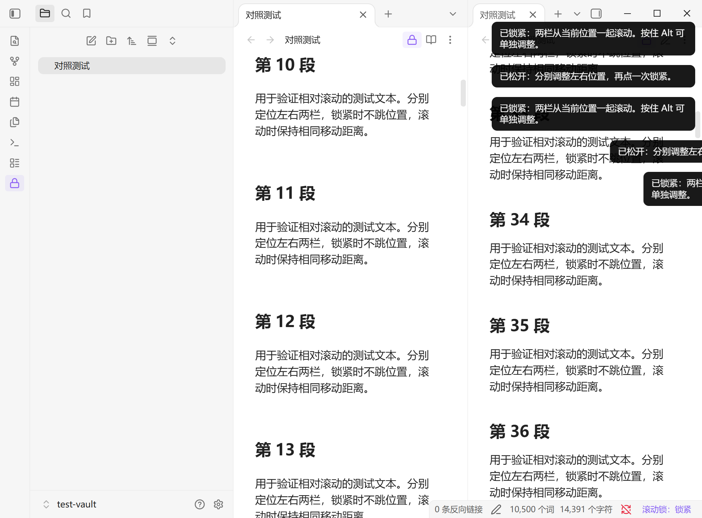

# Relative Scroll Lock · 滚动锁

**左右分别定位，点一下锁紧，再一起往下看。**

[English](README.en.md) · [下载安装包](https://github.com/v-49/obsidian-relative-scroll-lock/releases/latest) · [反馈问题](https://github.com/v-49/obsidian-relative-scroll-lock/issues)

在 Obsidian 中对照原文与修订稿时，你可能把同一篇笔记开成左右两栏：左边看后面的整理稿，右边看前面的原文。两栏需要从不同位置一起滚动，遇到错位时又要能随时单独调整。

这个插件提供一个可以反复锁紧、松开的滚动锁。**锁紧瞬间不会把两栏拉到相同位置。**



截图来自独立测试库，内容为人工生成的测试文本。

## 三个操作

| 操作 | 结果 |
| --- | --- |
| 分别定位两栏，点底部「滚动锁：松开」 | 从当前两个位置锁紧；滚动任意一栏，另一栏移动相同距离 |
| 再点一次 | 松开，两栏恢复独立滚动；调整后可以再次锁紧 |
| 按住 **Alt** 滚动其中一栏 | 临时只调整这一栏；松开 Alt 后，从新位置继续联动 |

左侧工具栏和笔记右上方也有锁图标，功能与底部按钮相同。界面随 Obsidian 语言显示中文或英文。

## 适合什么场景

- 同一篇长笔记中，对照原文与整理稿、前后版本、不同章节。
- 两篇笔记中，对照原文与译文、需求与方案、草稿与修订稿。
- 两栏段落长短不同，边看边用 Alt 修正位置。

### 与原生「关联标签页」的区别

原生关联主要用于同一篇笔记的对应位置。滚动锁允许你**先自行选择两栏的起点**，之后只同步移动距离。

例如，左栏停在第 80 段、右栏停在第 10 段，点锁紧后仍停在那里；左栏往下滚 200 像素，右栏也从自己的位置往下滚 200 像素。

它不会识别哪两段内容相互对应。文本长短不同造成错位时，松开重调，或按住 Alt 单独调整。

## 安装

**目前通过 GitHub Releases 分发，尚未上架 Obsidian 社区插件库。**

1. 打开 [最新发布页](https://github.com/v-49/obsidian-relative-scroll-lock/releases/latest)，下载 `relative-scroll-lock-1.0.0.zip`。
2. 解压，将里面的 `relative-scroll-lock` 文件夹放入知识库的插件目录。默认位置为 `.obsidian/plugins/`；如果改过配置目录，请使用实际配置目录下的 `plugins/`。
3. 确认目录结构如下，然后重新加载 Obsidian。
4. 在「设置 → 第三方插件」中启用 **Relative Scroll Lock**。如果受限模式已开启，需要先关闭受限模式。

```text
<知识库>/.obsidian/plugins/relative-scroll-lock/
├── main.js
├── manifest.json
└── styles.css
```

也可在发布页分别下载这三个文件。不要把 GitHub 自动生成的 `Source code` 压缩包当作安装包；源码需先构建。

### 第一次使用

1. 在 Obsidian 主区域开成左右两栏，打开同一篇或不同笔记。
2. 分别滚到要对照的段落。
3. 点底部「滚动锁：松开」。显示「滚动锁：锁紧」后即可同步滚动。

不用先操作原生「关联标签页」。如果这两栏已经原生关联，**点击锁紧会解除它们之间的原生关联**，交由滚动锁控制。松开、停用插件不会恢复原生关联；需要时可在标签页右键菜单中重新关联。

### 快捷键

公开版不预设快捷键，避免与其他功能冲突。可在「设置 → 快捷键」中搜索 **Relative Scroll Lock**，为「锁紧 / 松开」绑定自己习惯的按键，例如 `Ctrl + Alt + L`。

命令面板中也有「锁紧 / 松开」和「松开」命令。

## 支持范围与限制

- 桌面端；最低要求 **Obsidian 1.13.7**。本地原版在 Windows / Obsidian 1.13.7 中测试，公开构建在 Windows / Obsidian 1.14.4 中复验通过；macOS、Linux 尚未实机验证。
- 主区域必须恰好有两个可见的左右分栏 Markdown 视图。侧栏不计入；隐藏标签页不计入。
- 支持同一篇笔记；支持实时预览、源码模式、阅读模式及混合显示。
- 不支持 PDF、Canvas、移动端、弹出窗口、上下分栏或三个以上可见主面板。
- 启用插件和重启应用后默认松开。切换文件、切换显示模式、改变为不支持的布局时自动松开。
- 某栏到达顶部或底部时停在那里，另一栏可以继续滚动；反向滚动时按当前位置继续，需要时重新调整对齐。
- 同步的是**像素移动距离**，不是段落、行号或全文滚动百分比；不同字号、缩放、折叠、图片加载和内容编辑可能改变视觉对应关系。

## 数据与隐私

插件不读取或修改笔记正文，不添加 frontmatter，不联网、不遥测、不需要账号或付费。运行时没有第三方依赖，使用 Obsidian 自带的插件 API。

它访问的是当前视图、文件路径、分栏布局及滚动容器。点击锁紧时可能解除两栏原生关联；这会影响工作区关联状态，Obsidian 会保存工作区布局。插件不保存滚动位置或配对关系。

## 开发与验证

```sh
npm ci
npm run check
npm run package
```

`src/main.js` 是源码；`npm run build` 通过 esbuild 生成发布用的 `main.js`。`npm run package` 将安装文件复制到 `dist/relative-scroll-lock/`。

- 自动化回归测试覆盖锁紧不跳位、双向滚动、松开重锁、Alt 调整、边界、模式/文件/布局切换、按钮与中英文界面。
- 本地版和公开构建均已在真实 Obsidian 的编辑/编辑、阅读/阅读、编辑/阅读组合中验证，包含鼠标滚轮和命令调用；详见 [验证说明](docs/validation.md)。
- 源码模式沿用相同编辑器滚动容器，尚未单独进行真实应用场景验证。

本插件在真实审查场景中使用 AI 辅助开发。截图和测试文本均为演示内容，不包含用户笔记。

## 反馈与许可

遇到问题请 [提交 Issue](https://github.com/v-49/obsidian-relative-scroll-lock/issues)，说明 Obsidian 版本、操作系统、两栏模式与复现步骤。提交截图或示例前请移除私人信息。

[MIT License](LICENSE)。免费、开源；与 Obsidian 官方无隶属关系。
